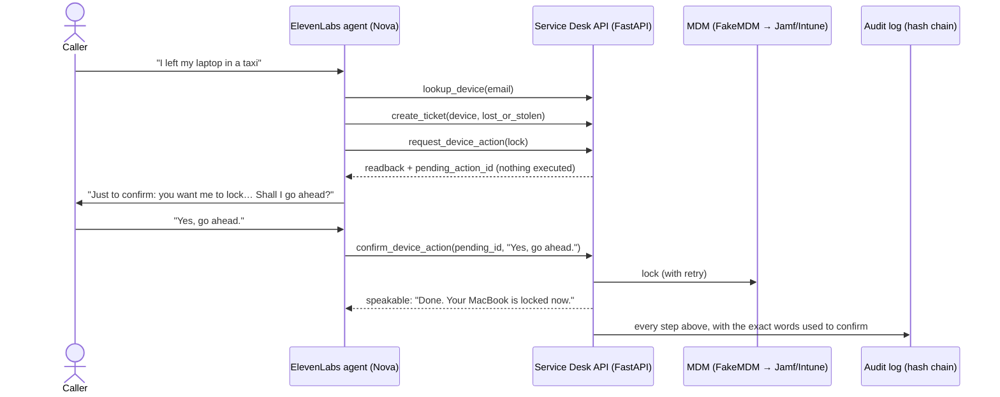

# Voice IT Service Desk Agent

A phone-style IT help desk you can talk to. **Nova**, an ElevenLabs voice agent, looks up the caller's
device, opens a support ticket, and performs remote device actions (restart, lock, wipe) through a
Python API. The API **will not act on a device without an explicit, fresh, spoken confirmation** from
the device's owner, and every step lands in a tamper-evident audit log.

Everything is fictional: *Northwind Labs*, its employees, and its devices.



## Why confirmation is enforced on the server

Telling the agent "always ask before acting" in its prompt is necessary but not sufficient. LLMs can
skip steps, and prompt injection exists. So the API enforces it:

| Guard | What it stops |
|---|---|
| **Two-step actions.** `request_device_action` only creates a *pending* action and returns a readback. Only `confirm_device_action` executes. | The agent acting without asking. |
| **The caller's exact words are sent and judged server-side.** Any negation wins ("yes, wait…" → declined). Ambiguity → ask again. | The agent paraphrasing hesitation into consent. |
| **Wipe requires "yes" + the asset tag's digits.** | Irreversible actions on a casual "yeah". |
| **2-minute expiry, single-use, bound to the conversation ID.** | Stale or replayed confirmations, and confirming from another call. |
| **3 failed attempts → locked out** and escalated on the ticket. | Brute-forcing the wipe code. |
| **Owner check.** Only the device's owner can request actions. Ticket must match the device. | Acting on someone else's laptop. |
| **Atomic claim** (`pending → executing`) before calling the MDM. | Double execution from retried tool calls. |

Limitation: the server sees a transcript, not audio. It can't prove a human said the words, only that
the agent *claims* they did, and the audit log records exactly what was claimed. A production version
would add caller verification (SSO push, a callback to the number on file) for wipe.

## Quickstart

```bash
python3 -m venv .venv && source .venv/bin/activate
pip install -r requirements-dev.txt
pytest -q                                              # 62 tests, < 1s

uvicorn app.main:create_app --factory --port 8000      # API + docs at http://localhost:8000/docs
python scripts/demo_call.py                            # replay the demo call in your terminal
```

Configuration is environment variables only; see `.env.example`. Set `MDM_FAULT=outage` to demo
graceful failure (`flaky` fails once, then the retry succeeds).

## Connecting the ElevenLabs agent

1. Expose the API: `ngrok http 8000` (or deploy to Render/Fly/Railway; it's one process + SQLite).
2. In ElevenLabs → **Agents** → *Create agent* (blank):
   - **System prompt:** paste `elevenlabs/system_prompt.md`.
   - **First message:** "Hi, you've reached Northwind IT. I'm Nova. What's going on?"
   - **LLM:** a fast model with good tool calling; **temperature** low (≈0.2).
   - **Voice:** something calm. Turn on interruptions; set end-of-turn timeout ~1s.
3. **Secrets:** add a workspace secret `TOOL_SECRET` with the same value as the API's `TOOL_SECRET`.
4. **Tools:** add one *Webhook* tool per entry in `elevenlabs/tools.json`. Replace `{{BASE_URL}}`,
   set header `X-Tool-Secret` from the secret, and set each `conversation_id` body parameter to the
   **dynamic variable** `system__conversation_id`. (The JSON follows the shape of ElevenLabs' tool config;
   if the dashboard fields have moved, the names and descriptions are what matter.)
5. Test in the dashboard widget, then watch `GET /admin/audit?conversation_id=…` fill up.

## API

All tool endpoints are `POST /tools/<name>` with `X-Tool-Secret`. Admin endpoints need `X-Admin-Key`.

| Endpoint | Purpose |
|---|---|
| `lookup_device` | By `email` (all their devices) or `asset_tag` (tolerates "nw 1042", "1042"). Serials masked to last 4. |
| `create_ticket` | Idempotent per conversation + device. `lost_or_stolen` is never below `high`. |
| `get_ticket` | Status and latest note. Accepts "inc 1001". |
| `request_device_action` | Step 1. Returns `readback`, `pending_action_id`, `expires_at`. Executes nothing. |
| `confirm_device_action` | Step 2. Takes the caller's verbatim words. Executes, cancels, or rejects. |
| `cancel_device_action` | Caller changed their mind. |
| `GET /admin/audit` | Audit entries, optionally filtered by `conversation_id`. |
| `GET /admin/audit/verify` | Recomputes the hash chain; reports the first tampered row. |

### One response shape

```json
{"ok": false,
 "error": {"code": "MDM_UNAVAILABLE", "message": "MDM API timed out", "details": {"ticket_id": "INC-1001"}},
 "speakable": "I couldn't reach the device management system, so nothing has been changed yet. I've noted it on your ticket and a technician will follow up.",
 "request_id": "9f2c1a0b7d3e"}
```

Every response, success or failure (including validation errors and unexpected 500s), carries a
`speakable` sentence. The agent always has something true to say, and internals never leak into speech.
Status codes are real (401/403/404/409/410/422/502/500) for anything that isn't a voice client.

## Error handling

- **Upstream (MDM) failures:** 3 attempts with exponential backoff, then the action is marked `failed`,
  the ticket gets a note, and the caller hears that *nothing changed*. Failed actions can't be
  re-confirmed; they must be requested again.
- **Offline devices:** commands are *queued*, as real MDMs do. The device isn't marked locked until it is.
- **Unexpected exceptions:** generic 500 envelope (no stack traces or messages leak), the action is marked
  `failed` so it can't get stuck mid-execution, and the error is logged with the request ID.
- **Speech-to-text noise:** asset tags, ticket IDs, emails, and spoken digits ("one oh four two") are normalised.

## Audit log

`audit_log` is append-only (a trigger blocks `DELETE`) and hash-chained: each row stores
`sha256(prev_hash | ts | request_id | conversation_id | actor | event | target | details)`. Edit any
past row and `/admin/audit/verify` names it. Entries are written **in the same transaction** as the state
change they describe, and rejected requests (bad auth, owner mismatch, failed confirmations) are logged too.

## Layout

```
app/
  main.py          FastAPI app factory, auth, request IDs, error envelope
  services.py      business rules + the request → confirm state machine
  confirmation.py  interpreting spoken yes/no and digit codes
  audit.py         hash-chained audit log
  mdm.py           MDM client protocol + FakeMDM (fault injection)
  db.py, seed_data.py, models.py, errors.py, config.py
elevenlabs/        system prompt + webhook tool definitions
scripts/demo_call.py   terminal replay of the demo call
tests/             62 tests: confirmation rules, actions, errors, audit tampering
docs/DEMO.md       90-second demo script     docs/PLAN.md   build plan
```

## Swapping in a real MDM

`MDMClient` is a one-method protocol. A Jamf Pro implementation would map `lock` → `DeviceLock`,
`wipe` → `EraseDevice`, and `restart` → `RestartDevice` MDM commands via the Jamf Pro API (OAuth2 client
credentials), and raise `MDMUnavailable` on timeouts/5xx. Nothing else changes.
